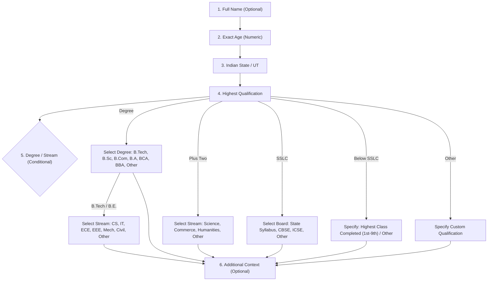
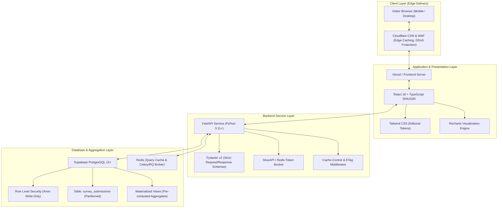
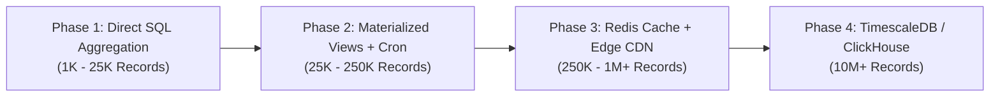

# GEMINI.md — India Employment Public Voice

> **Master Architecture, Design Philosophy, and Engineering Specification**  
> *Long-Term Source of Truth for the India Employment Public Voice Platform*  
> *Document Version: 2.0.0 • Classification: National Civic Participation & Awareness Movement*

---

## 1. Executive Summary & Project Vision

### 1.1 Project Identity & Purpose
The **India Employment Public Voice** platform is an independent, nationwide youth movement and public-interest crowdsourced observatory. It is not an impersonal government statistics portal, traditional broadsheet newspaper, corporate dashboard, or generic survey form.

Its primary emotional and civic objective is to inspire every young citizen:  
> *"Unemployment is a serious issue. My experience matters. I want to participate and make my voice count."*

Through voluntary, crowdsourced, and anonymous participation paired with honest data aggregation, the platform surfaces grassroots economic realities: what happens after graduation, regional employment disparities, the reality of engineering disciplines, and the daily perseverance of Indian youth.

### 1.2 Core Architectural Axiom: NOT a Job Portal
- **Zero Job Board Functionality:** The platform does not host job vacancies, accept resumes, provide employer recruitment dashboards, match candidates to recruiters, or charge fees.
- **Pure Civic Voice & Transparency:** The entire system is dedicated to voluntary citizen participation, demographic aggregation, open data journalism, and national awareness.
- **Public Utility:** Aggregated intelligence is accessible to every citizen, student, policy researcher, journalist, and academic without paywalls, accounts, or tracking.

### 1.3 Voluntary Survey vs. Official National Statistics (Crucial Distinction)
The platform must **never** mislead the public or present its metrics as official state apparatus data.
- **Voluntary Sample Disclaimer:** The platform operates on self-reported, voluntary public responses. It reflects sample distributions and self-selected respondent sentiment.
- **Statutory Demarcation:** The UI, APIs, and exported reports must prominently state:  
  > *"These statistics reflect voluntary survey responses submitted to India Employment Public Voice and do not represent official government metrics published by the Ministry of Statistics and Programme Implementation (MOSPI), the Periodic Labour Force Survey (PLFS), or the Reserve Bank of India (RBI)."*
- **Contextual Benchmarking:** Where appropriate, the platform may present PLFS/MOSPI reference baselines alongside platform findings to provide academic grounding.

### 1.4 Dual Entry Architecture (The Movement Ballots)
The platform establishes an egalitarian, binary participation mechanism immediately prominent on the homepage:
1. **`I AM EMPLOYED`** — Paths into the 6-question employed cohort survey.
2. **`I AM UNEMPLOYED`** — Paths into the 6-question unemployed cohort survey.

This duality ensures parity between working and non-working citizens, eliminating stigma and establishing both cohorts as equal contributors to national economic transparency.

---

## 2. Core Functionality & Specifications

### 2.1 Campaign Homepage Architecture
The homepage is designed as an energetic, modern civic campaign landing experience:

#### Required Sections & Information Architecture:
1. **Navigation Bar & Movement Ticker:** Platform identity, live participant ticker ($N = 48,312$ verified voices), navigation links (`Home`, `Participate`, `Employment Data`, `About`), and primary `COUNT MY VOICE` action button.
2. **Campaign Hero Section:** 
   - Full-screen / near-full-screen opening statement.
   - Commanding Headline: *"India has millions of dreams. How many are still waiting for a job?"*
   - Supporting Narrative: *"Employment is more than a statistic. Every person's experience tells a story. Share yours and help create a clearer picture of employment in India."*
   - Primary CTA: `I WANT MY VOICE COUNTED` (scrolls to participation arena).
   - Secondary CTA: `EXPLORE INDIA'S EMPLOYMENT PICTURE` (navigates to analytics dashboard).
   - Real database verified participant counter with 100% voluntary disclaimers.
3. **The National Participation Arena (Core Choice):**
   - Two massive, visually distinct participation cards:
     - **Card A: `I AM EMPLOYED`** (*"Working today? Share your employment experience and help understand India's workforce."* Button: `COUNT MY VOICE`).
     - **Card B: `I AM UNEMPLOYED`** (*"Looking for work? Your experience matters. Help show the reality behind the numbers."* Button: `COUNT MY VOICE`).
   - Both cards trigger the survey wizard for their respective cohort.
4. **Why Participate Section (3 Transparent Steps):**
   - Step 1: *SHARE YOUR EXPERIENCE* — 6 simple questions (under 90 seconds).
   - Step 2: *ADD YOUR VOICE* — Directly contributes to the collective picture.
   - Step 3: *SEE THE BIGGER PICTURE* — Explore anonymous aggregated results.
   - Demarcation notice: Voluntary public survey, not an official government voting exercise.
5. **National Employment Pulse:**
   - Real aggregated statistics with modern charts: Total verified responses, Employed vs Unemployed breakdown, Education outcomes, Top engineering disciplines, and Job-search duration.
6. **Human Storytelling Section:**
   - Headline: *"Behind every number, there is a person."*
   - Illustrative composite scenarios representing first-generation graduates, exam aspirants, and career-pivot youth (explicitly labelled as illustrative composites).
7. **Final High-Impact Movement CTA:**
   - Headline: *"Your experience should not remain invisible."*
   - Button: `ADD MY VOICE`
8. **About the Creator Section (Shafeek Latheef):**
   - Positioned near bottom before footer with verified links (Portfolio, GitHub, LinkedIn, Email).
9. **Site-wide Campaign Footer.**

---

### 2.1.1 Creator Section Specification ("About the Creator")

Positioned immediately before the primary campaign footer, this section provides transparent, restrained, and authentic attribution for the creator of the India Employment Public Voice platform.

#### Verified Creator Information:
- **Name:** Shafeek Latheef
- **Role:** Software Engineer • Full-Stack Developer • AI & Systems Builder
- **Description:** A Computer Science graduate from Kerala, India, passionate about building useful technology products and exploring how technology can solve real-world problems.
- **Verified Personal & Contact Channels (Clickable):**
  - **Portfolio:** [https://shafeektech.site](https://shafeektech.site)
  - **GitHub:** [https://github.com/shafeek32](https://github.com/shafeek32)
  - **LinkedIn:** [https://www.linkedin.com/in/shafeek-latheef/](https://www.linkedin.com/in/shafeek-latheef/)
  - **Email:** [shafeekl2002@gmail.com](mailto:shafeekl2002@gmail.com)

#### Design, Layout & Campaign Styling Requirements:
1. **Positioning & Flow:**
   - Must be placed near the bottom of the homepage, directly before the site-wide campaign footer.
   - Demarcated by a subtle 1px hairline border (`#EEECE7` / `#262626`) and monospace badge: `BUILT FOR PUBLIC CIVIC AWARENESS`.
2. **Visual Aesthetics:**
   - Follows the platform's campaign visual identity: Warm White (`#FAF9F6`) / Deep Charcoal (`#171717`) canvas, high-contrast headings, muted neutral copy.
   - Avoids flashy tech portfolio tropes (e.g., floating 3D avatars, glowing particle canvas, neon gradient badges).
   - Clean, disciplined typography (`Plus Jakarta Sans` for the name, `Inter` for bio, `JetBrains Mono` for role and metadata).
3. **Interactive Link Architecture:**
   - Every personal link (Portfolio, GitHub, LinkedIn, and Email) must be rendered as an accessible, clickable anchor tag (`<a>`) with `rel="noopener noreferrer"` and `target="_blank"` (except email `mailto:`).
   - Accompanied by minimal, high-contrast monochrome SVG icons (e.g., Globe/External Link for Portfolio, GitHub Octocat, LinkedIn mark, Mail envelope).
   - Clear text labels alongside icons for accessibility and unambiguous navigation.
   - Crisp hover state with subtle border shift and scale.
4. **Responsive Behavior:**
   - **Desktop:** Balanced card layout (left: name, role badge, bio; right: structured contact/link grid with hairline dividers).
   - **Tablet:** Flexible balanced grid with ample breathing room.
   - **Mobile (320px–480px):** Single-column stacked arrangement with touch-friendly button targets (minimum $48\text{px} \times 48\text{px}$ tap zones).
5. **Strict Editorial Boundaries:**
   - **No Phone Number:** Strictly forbidden to display telephone or mobile numbers.
   - **No Embellishments:** Do not fabricate, inflate, or invent awards, accolades, corporate partnerships, or client testimonials. All text must strictly adhere to the verified details above.

---

### 2.2 Unemployed Survey (Strict 6-Question Specification)

The unemployed questionnaire contains **exactly six questions**. To maximize completion rate and user trust, questions must not be added, split, or rearranged without architectural review.



#### Detailed Question Breakdown:

1. **Question 1: Full Name**
   - *Type:* Text input.
   - *Requirement:* **Strictly Optional**.
   - *Privacy Guarantee:* Never displayed publicly, never exposed via APIs, encrypted at rest, used solely for de-duplication heuristic checks.
   - *UI Placeholder:* *"Optional — You may leave this blank"*

2. **Question 2: Exact Age**
   - *Type:* Positive Integer Input (Numeric keypad on mobile).
   - *Validation Rules:* `14 <= age <= 100`. (Rejects age ranges; precise numbers enable granular demographic clustering).
   - *Helper Text:* *"Enter your exact age in years"*

3. **Question 3: Indian State or Union Territory**
   - *Type:* Searchable single-select dropdown.
   - *Data Source:* Canonical list of 28 States and 8 Union Territories of India (ISO 3166-2:IN).
   - *Validation:* Required.

4. **Question 4: Highest Educational Qualification**
   - *Type:* Single-choice select / segmented control.
   - *Options:*
     - `Postgraduate & Above` (Masters, Ph.D., Postdoc)
     - `Degree (Undergraduate / Bachelor's)`
     - `Diploma (Polytechnic / Vocational)`
     - `Plus Two (+2 / Higher Secondary / 12th Standard)`
     - `SSLC (10th Standard / Matriculation)`
     - `Below SSLC`
     - `Other`

5. **Question 5: Degree, Stream, or Specialization (Conditional Branching)**
   - *Dependency:* Dynamically rendered based on Question 4.
   - **Branch A — If `Degree` is selected:**
     - Primary options:
       - `B.Tech / B.E. (Engineering)`
       - `B.Sc. (Bachelor of Science)`
       - `B.Com. (Bachelor of Commerce)`
       - `B.A. (Bachelor of Arts)`
       - `BCA (Bachelor of Computer Applications)`
       - `BBA / BMS (Business Administration)`
       - `Other Degree` (With specification text field)
     - **Sub-branch for `B.Tech / B.E.`:**
       - Must display specific engineering branches:
         - *Computer Science & Engineering (CSE)*
         - *Information Technology (IT)*
         - *Electronics & Communication (ECE)*
         - *Electrical & Electronics (EEE)*
         - *Mechanical Engineering*
         - *Civil Engineering*
         - *Other Engineering Branch* (With text input)
   - **Branch B — If `Plus Two` is selected:**
     - Options: `Science`, `Commerce`, `Humanities / Arts`, `Vocational`, `Other`.
   - **Branch C — If `SSLC` is selected:**
     - Options: `State Syllabus`, `CBSE`, `ICSE`, `Open Schooling (NIOS)`, `Other`.
   - **Branch D — If `Below SSLC` is selected:**
     - Options: `Class 9`, `Class 8`, `Class 7`, `Class 6 or below`, `No formal schooling`.
   - **Branch E — If `Other` is selected:**
     - Single text field: *"Please specify your qualification"*.

6. **Question 6: Additional Information (Strictly Optional)**
   - *Type:* Structured micro-selectors (all optional).
   - *Capture fields:*
     - Duration of Unemployment: `< 6 months`, `6–12 months`, `1–2 years`, `2+ years`.
     - Primary Seeking Domain: Sector/Domain searching in (e.g., IT, Govt/Public Exams, Core Engineering, Teaching, Banking, Open to Any).
     - Looking for Work Type: Full-time, Part-time, Apprenticeship, Remote.

---

### 2.3 Employed Survey (Strict 6-Question Specification)

The employed questionnaire mirrors the unemployed survey in structure and length, ensuring symmetric cognitive investment.

#### Detailed Question Breakdown:

1. **Question 1: Full Name**
   - *Type:* Text input.
   - *Requirement:* **Strictly Optional**. Never displayed publicly.

2. **Question 2: Exact Age**
   - *Type:* Positive Integer Input (`14 <= age <= 100`).

3. **Question 3: Current Working State / Union Territory**
   - *Type:* Searchable single-select dropdown (28 States + 8 UTs + `Working Remotely / Outside India`).
   - *Context:* Captures where the economic activity is physically or contractually situated.

4. **Question 4: Highest Educational Qualification**
   - *Options & Logic:* Exactly identical to Unemployed Survey Question 4.

5. **Question 5: Degree and Stream (Conditional Logic)**
   - *Cascading Logic:* Exactly identical to Unemployed Survey Question 5 (including full B.Tech engineering stream branches).

6. **Question 6: Additional Employment Details (Strictly Optional)**
   - *Type:* Compact multi-attribute group.
   - *Attributes:*
     - **Employment Category:** `Private Sector`, `Central / State Government`, `Public Sector Undertaking (PSU)`, `Self-Employed / Business Owner`, `Freelancer / Gig Economy`, `Informal / Daily Wage`.
     - **Industry Sector:** `Information Technology / Software`, `Manufacturing / Industrial`, `BFSI (Banking, Financial Services, Insurance)`, `Healthcare / Pharma`, `Education / EdTech`, `Retail / E-Commerce`, `Agriculture / Allied`, `Construction / Real Estate`, `Other`.
     - **Monthly In-Hand Compensation Band (INR):** `< ₹15,000`, `₹15,000 – ₹30,000`, `₹30,000 – ₹50,000`, `₹50,000 – ₹1,00,000`, `₹1,00,000 – ₹2,00,000`, `> ₹2,00,000`, `Prefer not to say`.
     - **Total Work Experience:** `< 1 year`, `1–3 years`, `3–5 years`, `5–10 years`, `10+ years`.
     - **Job Alignment & Satisfaction:** `Employed in My Field of Study` (Yes/No), `Job Satisfaction` (1 to 5 scale).

---

### 2.4 Public Statistics Dashboard & Data Simplification

The public dashboard is the analytical core of the platform. Its primary mission is to make crowdsourced data understandable to every Indian citizen within 3 seconds, without technical jargon, complex formulas, or confusing statistical terminology.

#### Core Human-First Visualizations:
1. **The 100-Person Human Ratio (Employment Overview):**
   - Replaces abstract percentages with relatable language: *"Out of every 100 people who participated, 62 said they were employed and 38 said they were unemployed."*
   - Supported by a clear two-color horizontal bar (Forest Green for employed, Campaign Red for unemployed) with visible counts and clear labels.
2. **Education Groups Among Unemployed Respondents:**
   - Question Title: *"Which education groups are represented among unemployed respondents?"*
   - Simple horizontal bars showing exact counts of unemployed respondents alongside total participants across College Degrees, Postgraduates, Diplomas, Plus Two, and SSLC.
   - Clear explanatory note that counts reflect who participated in the survey, not official group unemployment rates.
3. **Ranked State-Wise Participation:**
   - Question Title: *"Where did survey participants come from?"*
   - Simple ranked list with horizontal bars showing total respondents, employed counts, and looking-for-work counts for each state.
   - Searchable filter to find any state in 1 second.
   - Explicit demarcation: *"These numbers show where survey participants came from. They do not indicate which state has the highest unemployment rate."*
4. **5 Understandable Age Groups:**
   - Question Title: *"Which age group took part the most?"*
   - Groups respondents into 5 intuitive brackets: **18–20 years**, **21–25 years**, **26–30 years**, **31–35 years**, and **Above 35 years**.
   - Clean horizontal bars with visible counts and youth transition insights.
5. **Engineering Branch Comparison:**
   - Question Title: *"How many respondents from each engineering branch reported being unemployed?"*
   - Simple horizontal bars comparing CSE, Mechanical, ECE, Civil, EEE, IT, and Other engineering branches with exact counts.
   - Cautionary note explaining that Computer Science has the highest count because it has the largest enrollment in India, not because of a worse job market.
6. **Side-by-Side Bilateral State Comparison Tool:**
   - Compares any two Indian states in plain numbers (Total Participants, Employed, and Looking for Work) with human sentences.

#### Plain-Language Filtering Engine:
- **"Show Responses From"** (All, Employed Only, Looking for Work Only).
- **"Choose a State"** (All India or any specific State/UT).
- **"Select Education Level"** (All or specific educational tier).
- **"Select Engineering Branch"** (All or specific B.Tech branch).
- **Active Matching Counter:** Live count displaying *"Showing X matching people"*.
- **One-Click Reset:** Prominent "Reset All Filters" button.

#### Data Integrity & Privacy Protocols:
- **Zero Mock/Synthetic Data:** Every number displayed in production originates directly from actual database aggregation.
- **K-Anonymity Privacy Floor ($k=5$):** Any filtered combination resulting in fewer than 5 submissions is hidden to protect participant privacy.
- **Statutory Demarcation:** Prominently clarifies that survey metrics reflect voluntary crowdsourced submissions and do not represent official government statistics published by MOSPI, PLFS, or RBI.

---

## 3. Design Philosophy & Campaign Visual Identity

### 3.1 The Human-Centered Campaign Manifesto
The web is saturated with homogenised, AI-generated SaaS templates, generic corporate dashboards, and boring survey forms. India Employment Public Voice rejects these tropes entirely in favor of an energetic, high-contrast, movement-inspired visual identity that honors the lived experiences of India's youth.

| Forbidden Generic Trope | Campaign Alternative for This Platform |
| :--- | :--- |
| Purple/blue neon gradient mesh backgrounds | Bold high-contrast canvas with Warm White (`#FAF9F6`) and Deep Charcoal (`#171717`) |
| Floating glassmorphism cards with blurry backdrops | Solid, high-contrast cards with crisp 1px borders and subtle shadow accents |
| Generic rounded pill buttons with glowing drop-shadows | Massive, punchy action buttons with clear, tactile hover and tap feedback ($\ge 48\text{px}$) |
| Meaningless floating 3D spheres, donuts, and squiggles | Authentic statistical visualizations, relatable youth narratives, and clear data cards |
| Giant empty hero spaces with 3-word buzzwords | Emotionally resonant opening headlines: *"India has millions of dreams. How many are still waiting for a job?"* |
| Identical cookie-cutter 3-column feature grids | Asymmetric, campaign-driven sections with clear visual hierarchy |
| Tiny, cramped survey forms resembling government paperwork | Welcoming one-question-per-screen wizard with large touch targets and real progress indicators |
| Stock 3D cartoon avatars and generic illustrations | Clean data graphics, real demographic insights, and human-centered composite stories |

### 3.2 Visual Heritage & Movement Energy
The aesthetic blends the gravitas of public-interest data journalism with the passionate momentum of civic youth campaigns:
- **Public Awareness Campaigns:** High-visibility callouts, punchy slogans, bold typography, and undeniable urgency.
- **Modern Data Journalism (The Pudding, NYT Upshot, Our World in Data):** Clarity of information, accessible chart labels, and direct storytelling through numbers.
- **Tactile High-Contrast UI:** Clear visual distinction between working cohorts, making participation feel consequential and empowering.

### 3.3 Colour Architecture

```
Deep Charcoal    #171717   (Primary Text, Dark Sections, Heavy Structural Frames)
Campaign Red     #F15B48   (Unemployed Data Series, Urgent Voice CTAs, Key Badges)
Warm White       #FAF9F6   (Primary Canvas Background, Clean Card Backgrounds)
Electric Orange  #FF8A3D   (Secondary Accents, Highlight Pills, Live Indicators)
Forest Green     #176B52   (Employed Data Series, Verification Marks, Success States)
Light Neutral    #EEECE7   (Dividers, Muted Card Backgrounds, Inactive Fills)
White (Pure)     #FFFFFF   (Chart Canvas Insets, Form Input Surfaces)
```

#### Color Application Rules:
- **Semantic Consistency:** `Forest Green` (`#176B52`) is strictly reserved for *Employed* data; `Campaign Red` (`#F15B48`) is strictly reserved for *Unemployed* data and urgent movement calls.
- **High-Contrast Readability:** All text combinations meet WCAG AA / AAA contrast ratios against Warm White and Deep Charcoal surfaces.
- **Intentional Accentuation:** `Electric Orange` (`#FF8A3D`) is used strategically for live badges, step numbers, and engagement indicators.

### 3.4 Typography System

The platform relies on three modern, highly legible font families:

```
┌────────────────────────────────────────────────────────┐
│  DISPLAY HEADINGS: Plus Jakarta Sans (Extrabold / 800) │
│  "India has millions of dreams."                       │
├────────────────────────────────────────────────────────┤
│  BODY & UI: Inter (Regular / Medium, 400 / 500)        │
│  "Employment is more than a statistic. Share yours."   │
├────────────────────────────────────────────────────────┤
│  DATA, METRICS & LABELS: JetBrains Mono (Bold / 700)   │
│  N = 48,312 | 28.4% | B.TECH CSE | IST 14:32:00        │
└────────────────────────────────────────────────────────┘
```

#### Typographic Hierarchy:
- **Hero Title:** `Plus Jakarta Sans`, 40px–64px desktop / 32px–40px mobile, 800 weight, line-height 1.1, tracking `-0.03em`.
- **Section Headers:** `Plus Jakarta Sans`, 28px–36px, 700 weight, line-height 1.2.
- **Section Eyebrows / Meta:** `JetBrains Mono`, 11px–13px, 600 weight, uppercase, tracking `+0.12em` (e.g., `NATIONAL PARTICIPATION ARENA`).
- **Body Text:** `Inter`, 15px–18px, 400/500 weight, line-height 1.6, color `#171717` or `#64645F`.
- **Numerical Metric Displays:** `JetBrains Mono`, tabular figures (`font-variant-numeric: tabular-nums;`), bold weights.

### 3.5 Layout, Grid & Touch Usability
- **Touch-Friendly Tap Zones:** All clickable options, radio pills, and buttons are designed with a minimum target height of $48\text{px}$ for seamless mobile usability.
- **Hairline Framing:** Subtle 1px borders (`#EEECE7` on light backgrounds, `#262626` on dark backgrounds) create crisp structure without visual clutter.
- **Single-Question Survey Layout:** The survey is presented one question at a time to reduce cognitive load and maximize completion rates on mobile devices.

### 3.6 Data Visualization Design Principles: The 3-Second Comprehension Standard

To ensure that every ordinary Indian citizen — regardless of educational background or statistical knowledge — can understand any statistic within 3 seconds, all charts and data representations adhere to the **5-Part Universal Comprehension Rule**:

1. **Simple Question as Title:** Every chart opens with an everyday conversational question (e.g., *"Which education groups are represented among unemployed respondents?"*).
2. **Clear Direct Number or Count:** Key numbers and counts are immediately visible directly on or adjacent to bars — never hidden inside hover tooltips.
3. **Simple Horizontal Visual:** Horizontal bars and proportional split bars are used exclusively instead of complex histograms, confusing pie charts, or dense multi-column tables.
4. **Plain Language Explanation:** A 1-to-2 sentence summary explaining what the numbers mean in simple everyday terms.
5. **Contextual Demarcation Note:** An explicit footnote explaining what the data represents (e.g., *"These numbers show where survey participants came from. They do not indicate which state has the highest unemployment rate"*).

#### Visual Styling of Bars:
- **Direct Labeling:** Exact counts (e.g. `11,280 people`) are rendered in `JetBrains Mono` or bold `Inter` directly next to each bar.
- **Color Consistency:** `Forest Green` (`#176B52`) for employed counts, `Campaign Red` (`#F15B48`) for unemployed counts, and `Deep Charcoal` (`#171717`) for total volume.
- **Mobile-First Responsiveness:** Horizontal bars stack naturally on 320px–480px screens without clipping labels or requiring horizontal scrolling.

### 3.7 The Cultural Voice & National Participation Arena
To connect authentically with India's youth and demystify the stress surrounding job hunting:
- **Relatable Ground Reality:** Balances serious economic inquiry with empathetic recognition of common struggles: campus placement pressure, preparing for exams, endless job applications, and career pivots.
- **High-Impact Participation Arena:**
  - Two massive cards (**`I AM EMPLOYED`** and **`I AM UNEMPLOYED`**) anchor the homepage.
  - Large, distinct action buttons (`COUNT MY VOICE`) make participation feel active and empowering.
  - Live participant counters and regional breakdowns demonstrate collective solidarity across all 36 States and Union Territories.

---

## 4. Technical Architecture

### 4.1 System Topology



### 4.2 Technology Stack Justification

| Layer | Selected Tech | Architectural Rationale |
| :--- | :--- | :--- |
| **Frontend Framework** | **React 18 + TypeScript** | Component reusability, type-safe conditional forms, large ecosystem for data charts. |
| **Styling Engine** | **Tailwind CSS** | Custom token configuration for editorial palettes, precise hairline border utilities, zero runtime CSS overhead. |
| **Data Visualization** | **Recharts + D3 Primitives** | Declarative React SVG rendering, responsive containers, seamless integration with Tailwind color tokens. |
| **Backend API** | **FastAPI (Python 3.11+)** | High-performance asynchronous execution, native OpenAPI documentation, strict Pydantic v2 validation, superior ecosystem for statistical computation. |
| **Primary Database** | **Supabase PostgreSQL** | Robust relational model, SQL-native aggregation, Materialized Views, Row Level Security, instant automated API capabilities if needed. |
| **Caching & Queue** | **Redis (Optional Phase)** | Key-value store for pre-computed aggregate JSON payloads, prevents direct DB hits for viral spikes. |
| **CDN & Security** | **Cloudflare** | Edge caching of static dashboard endpoints, Cloudflare Turnstile for silent bot prevention, DDoS shielding. |

---

### 4.3 Database Schema & Relational Architecture

The relational schema strictly isolates raw survey entries from public aggregation queries.

```sql
-- 1. Reference Lookup Tables
CREATE TABLE geo_states (
    id VARCHAR(10) PRIMARY KEY, -- e.g. 'IN-KA', 'IN-MH'
    name VARCHAR(100) NOT NULL,
    type VARCHAR(20) NOT NULL CHECK (type IN ('STATE', 'UT')),
    census_code VARCHAR(10)
);

CREATE TABLE education_qualifications (
    id VARCHAR(50) PRIMARY KEY,
    name VARCHAR(100) NOT NULL,
    tier_order INT NOT NULL
);

CREATE TABLE degree_types (
    id VARCHAR(50) PRIMARY KEY,
    qualification_id VARCHAR(50) REFERENCES education_qualifications(id),
    name VARCHAR(100) NOT NULL
);

CREATE TABLE academic_streams (
    id VARCHAR(50) PRIMARY KEY,
    degree_type_id VARCHAR(50) REFERENCES degree_types(id),
    name VARCHAR(100) NOT NULL,
    is_engineering BOOLEAN DEFAULT FALSE
);

-- 2. Core Survey Submissions Table
CREATE TABLE survey_submissions (
    id UUID PRIMARY KEY DEFAULT gen_random_uuid(),
    created_at TIMESTAMPTZ DEFAULT NOW() NOT NULL,
    status VARCHAR(20) NOT NULL CHECK (status IN ('EMPLOYED', 'UNEMPLOYED')),
    
    -- Q1: Full Name (Optional, Encrypted / Isolated)
    respondent_name VARCHAR(150),
    
    -- Q2: Exact Age
    age INT NOT NULL CHECK (age >= 14 AND age <= 100),
    
    -- Q3: State / Location
    state_id VARCHAR(10) NOT NULL REFERENCES geo_states(id),
    
    -- Q4: Qualification
    qualification_id VARCHAR(50) NOT NULL REFERENCES education_qualifications(id),
    
    -- Q5: Degree & Stream
    degree_id VARCHAR(50) REFERENCES degree_types(id),
    stream_id VARCHAR(50) REFERENCES academic_streams(id),
    custom_qualification_detail VARCHAR(200),
    
    -- Q6: Additional Metadata (Stored as structured JSONB for optional flexible fields)
    additional_attributes JSONB DEFAULT '{}'::jsonb,
    
    -- Anti-Abuse Integrity Hashes (Never published)
    ip_hash VARCHAR(64) NOT NULL,
    client_fingerprint VARCHAR(64)
);

-- 3. Security Indexes for Fast Aggregation
CREATE INDEX idx_survey_status ON survey_submissions(status);
CREATE INDEX idx_survey_state ON survey_submissions(state_id);
CREATE INDEX idx_survey_qualification ON survey_submissions(qualification_id);
CREATE INDEX idx_survey_degree ON survey_submissions(degree_id);
CREATE INDEX idx_survey_stream ON survey_submissions(stream_id);
CREATE INDEX idx_survey_age ON survey_submissions(age);
CREATE INDEX idx_survey_created_at ON survey_submissions(created_at);
CREATE INDEX idx_survey_composite_agg ON survey_submissions(status, state_id, qualification_id);
```

#### Supabase Row Level Security (RLS) Policy:
```sql
ALTER TABLE survey_submissions ENABLE ROW LEVEL SECURITY;

-- Anonymous public visitors can ONLY insert records. They CANNOT read raw submissions.
CREATE POLICY "Public anonymous users can insert submissions" 
ON survey_submissions 
FOR INSERT 
TO anon 
WITH CHECK (true);

-- No public SELECT policy on survey_submissions. Raw data is completely inaccessible to the browser.
-- Only the backend service role or SECURITY DEFINER aggregate functions can query the table.
```

---

### 4.4 Materialized Views for Instant Dashboard Rendering

To guarantee that queries remain sub-second even with millions of rows, the database uses pre-aggregated materialized views refreshed periodically.

```sql
-- Materialized View: State-wise summary
CREATE MATERIALIZED VIEW mv_state_employment_aggregates AS
SELECT 
    s.state_id,
    g.name AS state_name,
    COUNT(*) AS total_respondents,
    COUNT(*) FILTER (WHERE s.status = 'EMPLOYED') AS employed_count,
    COUNT(*) FILTER (WHERE s.status = 'UNEMPLOYED') AS unemployed_count,
    ROUND(AVG(s.age)::numeric, 1) AS average_age
FROM survey_submissions s
JOIN geo_states g ON s.state_id = g.id
GROUP BY s.state_id, g.name;

-- Materialized View: Engineering Stream breakdown
CREATE MATERIALIZED VIEW mv_engineering_stream_aggregates AS
SELECT 
    str.id AS stream_id,
    str.name AS stream_name,
    COUNT(*) AS total_respondents,
    COUNT(*) FILTER (WHERE s.status = 'EMPLOYED') AS employed_count,
    COUNT(*) FILTER (WHERE s.status = 'UNEMPLOYED') AS unemployed_count
FROM survey_submissions s
JOIN academic_streams str ON s.stream_id = str.id
WHERE str.is_engineering = TRUE
GROUP BY str.id, str.name;

-- Unique indexes on materialized views to enable CONCURRENT REFRESH
CREATE UNIQUE INDEX idx_mv_state_id ON mv_state_employment_aggregates(state_id);
CREATE UNIQUE INDEX idx_mv_stream_id ON mv_engineering_stream_aggregates(stream_id);
```

---

### 4.5 Repository Directory Structure

```
d:\unemployment/
├── GEMINI.md                            # Master Architecture & Project Instructions
├── frontend/                            # React 18 + TypeScript Client
│   ├── public/
│   │   ├── favicon.ico
│   │   └── fonts/                       # Local Playfair, Inter, IBM Plex Mono
│   ├── src/
│   │   ├── components/
│   │   │   ├── common/                  # Hairline cards, badges, buttons, typography
│   │   │   │   ├── Button.tsx
│   │   │   │   ├── EditorialHeader.tsx
│   │   │   │   ├── HairlineCard.tsx
│   │   │   │   ├── MetricNumber.tsx
│   │   │   │   └── TabularData.tsx
│   │   │   ├── layout/                  # Masthead, navigation, footer, disclaimers
│   │   │   │   ├── Masthead.tsx
│   │   │   │   ├── CreatorSection.tsx   # Verified Creator Profile & Channels
│   │   │   │   ├── EditorialFooter.tsx
│   │   │   │   └── MethodologyNote.tsx
│   │   │   ├── survey/                  # Strict 6-question survey modules
│   │   │   │   ├── SurveyWizard.tsx
│   │   │   │   ├── QuestionOneName.tsx
│   │   │   │   ├── QuestionTwoAge.tsx
│   │   │   │   ├── QuestionThreeState.tsx
│   │   │   │   ├── QuestionFourQualification.tsx
│   │   │   │   ├── QuestionFiveDegreeStream.tsx
│   │   │   │   └── QuestionSixAdditional.tsx
│   │   │   └── dashboard/               # Visualizations and analytics
│   │   │       ├── MacroMetricGrid.tsx
│   │   │       ├── StateDistributionChart.tsx
│   │   │       ├── AgeHistogramChart.tsx
│   │   │       ├── EngineeringBranchChart.tsx
│   │   │       ├── FilterSidebar.tsx
│   │   │       └── InterStateComparator.tsx
│   │   ├── hooks/
│   │   │   ├── useSurveyFlow.ts
│   │   │   ├── useAggregateData.ts
│   │   │   └── useDashboardFilters.ts
│   │   ├── services/
│   │   │   └── api.ts                   # Type-safe fetch wrappers
│   │   ├── types/
│   │   │   ├── survey.ts
│   │   │   └── analytics.ts
│   │   ├── App.tsx
│   │   ├── index.css                    # Tailwind imports & custom editorial tokens
│   │   └── main.tsx
│   ├── tailwind.config.js
│   ├── tsconfig.json
│   └── package.json
│
├── backend/                             # Python FastAPI Backend Service
│   ├── app/
│   │   ├── api/
│   │   │   ├── v1/
│   │   │   │   ├── endpoints/
│   │   │   │   │   ├── surveys.py       # Submission endpoints (POST only)
│   │   │   │   │   ├── analytics.py     # Public aggregate endpoints (GET only)
│   │   │   │   │   └── lookups.py       # States, degrees, streams
│   │   │   │   └── router.py
│   │   ├── core/
│   │   │   ├── config.py                # Environment settings & secrets
│   │   │   ├── security.py              # IP hashing, Turnstile verification
│   │   │   └── rate_limit.py            # SlowAPI rate limiting configuration
│   │   ├── db/
│   │   │   ├── session.py               # Supabase connection pool
│   │   │   └── queries.py               # Raw SQL & Materialized View readers
│   │   ├── schemas/
│   │   │   ├── survey.py                # Pydantic input models & validators
│   │   │   └── analytics.py             # Response models for aggregates
│   │   └── main.py                      # FastAPI factory & middleware setup
│   ├── requirements.txt
│   └── Dockerfile
│
└── supabase/                            # Supabase Migrations & Seeds
    ├── migrations/
    │   ├── 001_initial_schema.sql
    │   ├── 002_rls_policies.sql
    │   └── 003_materialized_views.sql
    └── seed_data.sql                    # Canonical Indian States & Degree Master
```

---

## 5. Scalability, Performance & Data Pipeline

### 5.1 Progression Strategy (From Inception to Millions of Submissions)



1. **Initial Scale ($N < 25,000$):**
   - Direct indexed SQL queries executed with Postgres `GROUP BY`.
   - FastAPI responses cached via standard HTTP `Cache-Control: public, max-age=60, s-maxage=300`.
2. **Intermediate Scale ($25,000 \le N \le 250,000$):**
   - Transition all dashboard queries to read strictly from `Materialized Views`.
   - Background worker (cron or Supabase pg_cron) executes `REFRESH MATERIALIZED VIEW CONCURRENTLY` every 10 minutes.
   - Zero read-lock impact on the primary write table (`survey_submissions`).
3. **High Scale ($N > 250,000$):**
   - Redis cluster stores pre-computed JSON snapshots of top-level metrics.
   - Cloudflare edge caches `/api/v1/analytics/summary` at regional nodes across India (Mumbai, Chennai, Delhi, Hyderabad).
   - Write requests are ingested through FastAPI async endpoints with non-blocking DB inserts.

### 5.2 Bot Prevention & Anti-Abuse Architecture
- **Silent Bot Screening:** Cloudflare Turnstile integration on the final step of the survey. Non-intrusive; requires no tedious picture-clicking puzzles.
- **Honeypot Traps:** A hidden form field `website_url` that is visually masked via CSS. If populated, the submission is silently dropped with a 200 OK status to fool malicious scripts.
- **Completion Velocity Filter:** Submissions completed in less than 3.5 seconds from form initialization are rejected as automated bot posts.
- **Salted IP Hashing:** The client IP is combined with a rotating secret key and hashed via SHA-256 before storage: `ip_hash = sha256(client_ip + DAILY_PEPPER)`. Raw IPs are **never** committed to disk.

---

## 6. Security, Privacy & Data Ethics (DPDPA 2023 Compliance)

### 6.1 Principles of Data Minimization
As a public-interest project handling personal demographic reports, the platform adopts an uncompromising privacy posture:
1. **No High-Risk Identifiers:** The platform **strictly forbids** collecting:
   - Aadhaar numbers
   - Permanent Account Numbers (PAN)
   - Phone numbers / Mobile OTPs
   - Email addresses
   - Exact physical home addresses or GPS coordinates
   - Bank or financial account identifiers
2. **Optional Names:** Names are completely voluntary. Users are explicitly informed they can leave the field empty or use a pseudonym.
3. **Permanent Segregation:** Even when provided, names are stored in an isolated column inaccessible to any public endpoint, analytics function, or data export.
4. **K-Anonymity ($k=5$):** The analytics API enforces a strict differential privacy floor. If any combined query (e.g., *"Age 34 + Civil Engineering + State: Sikkim"*) matches fewer than 5 respondents, the response returns:
   ```json
   {
     "status": "redacted",
     "reason": "k_anonymity_threshold_unmet",
     "minimum_required": 5,
     "sample_size": 2
   }
   ```

### 6.2 Compliance with India's Digital Personal Data Protection Act (DPDPA 2023)
- **Notice & Purpose Specification:** Before the first question, users are shown a concise, plain-language notice outlining that their anonymized data will be aggregated into public research charts.
- **Explicit Affirmative Consent:** A simple, mandatory consent toggle: *"I consent to contributing my anonymized responses to this public research platform."*
- **Right to Erasure / Revocation:** A submission confirmation presents a one-time random 16-character alphanumeric `Submission Key`. If a user later wishes to delete their record, they can enter this key on a dedicated `/privacy/delete` page without needing an account.

---

## 7. User Experience & Accessibility (a11y) Standards

### 7.1 Mobile-First Cognitive Ergonomics
Given that over 80% of Indian internet users access the web via smartphones:
- **Zero Horizontal Scrolling:** All layouts, tables, and charts must collapse cleanly on 320px–420px viewports.
- **Finger-Friendly Touch Targets:** All interactive inputs, buttons, and dropdown options must maintain a minimum bounding box of $48\text{px} \times 48\text{px}$.
- **Input Type Optimization:** Exact Age must trigger `inputmode="numeric"`, ensuring the device surfaces a numeric keypad immediately.

### 7.2 The 6-Question Survey Wizard
- **Step-by-Step Focus:** Present questions sequentially or in clean logical pairs to eliminate vertical cognitive fatigue.
- **Persistent Progress Marker:** A minimal, monospace indicator at the top: `QUESTION [03 / 06] — LOCATION`.
- **Zero Disorienting Layout Shifts:** When conditional options open (e.g., selecting `Degree` reveals `B.Tech`), the transition must expand smoothly without jumping the user's viewport.
- **Keyboard Traversal:** Complete keyboard support: `Tab` advances, `Arrow Keys` navigate segmented options, `Enter` confirms, `Escape` clears dropdowns.
- **Accessible State Handling:** All form inputs must feature explicit `aria-expanded`, `aria-controls`, and `aria-live` attributes for screen readers.

---

## 8. Development Rules & Engineering Conventions

### 8.1 Code Integrity & Component Governance
1. **No Overwriting Without Inspection:** Always inspect existing code and architecture before making modifications.
2. **Strict TypeScript:** No `any`. Declare comprehensive interfaces for every survey response, filter state, and aggregation metric.
3. **Separation of Concerns:**
   - Presentational UI components must remain stateless wherever possible.
   - Form state must reside in a dedicated state machine or custom hook (`useSurveyFlow`).
   - Chart rendering logic must not contain raw SQL or direct API fetch calls.
4. **Environment Variables:** All API keys, database credentials, and pepper keys must be loaded via typed configuration modules (`config.py` in FastAPI, `import.meta.env` in Vite/React). No hardcoded strings.
5. **No Mock Data in Production:** All dashboard views must fail gracefully to an empty state or error boundary if backend data is unreachable. Never inject fabricated numbers into production builds.

---

## 9. Future Development Roadmap

### Phase 1: Project Foundation & Editorial Visual Identity System
- [ ] Initialize repository structure (`frontend/` and `backend/`).
- [ ] Configure Tailwind CSS with custom editorial tokens (`#F7F5EF`, `#191B1A`, `#64645F`, `#176B52`, `#B84A35`, `#E6E3DB`).
- [ ] Load and configure web fonts: `Playfair Display`, `Inter` / `Manrope`, and `IBM Plex Mono`.
- [ ] Build core UI components: Hairline cards, buttons, monospace badges, and typography blocks.

### Phase 2: Homepage & Dual-Entry Architecture
- [ ] Construct the editorial masthead, date ticker, and live status bar.
- [ ] Implement the editorial hero narrative and introductory framing.
- [ ] Build the two primary gateway action cards: `[ I'M EMPLOYED ]` and `[ I'M UNEMPLOYED ]`.
- [ ] Develop the methodology overview section and ethical manifesto.
- [ ] Implement the "About the Creator" section (Shafeek Latheef) immediately before the footer with verified biographical links and editorial styling.

### Phase 3: The 6-Question Survey Modules
- [ ] Construct the unemployed survey flow with full conditional logic for all degrees and engineering streams.
- [ ] Construct the matching employed survey flow with sector, salary range, and satisfaction selectors.
- [ ] Implement client-side input validation, age constraints, and step transitions.
- [ ] Integrate Cloudflare Turnstile and anti-abuse honeypot fields.

### Phase 4: Supabase Database, RLS & Secure API Architecture
- [ ] Deploy Supabase PostgreSQL schema with lookup tables and composite indexes.
- [ ] Configure Row Level Security (RLS) policies allowing `anon` INSERT only.
- [ ] Build FastAPI asynchronous ingestion endpoint (`POST /api/v1/surveys/submit`).
- [ ] Implement salted IP hashing, completion velocity checking, and Pydantic validation.

### Phase 5: Public Analytics Dashboard & High-Density Metrics
- [ ] Build Materialized Views in PostgreSQL for lightning-fast aggregated rollups.
- [ ] Develop FastAPI endpoints (`GET /api/v1/analytics/overview`, `GET /api/v1/analytics/states`).
- [ ] Implement the Macro Metric Grid on the frontend displaying total respondents, employed/unemployed splits, and median ages.
- [ ] Build the interactive multi-dimensional filter bar (State, Age, Qualification, Stream, Date).

### Phase 6: Interactive Editorial Charts & Deep Stream Analysis
- [ ] Implement the State-wise geographical comparison chart with sorting and ranking.
- [ ] Develop the single-year age distribution histogram.
- [ ] Build the engineering branch analysis module (CSE vs. IT vs. ECE vs. Mechanical vs. Civil).
- [ ] Integrate the dual-state comparison tool with side-by-side metric inspection.
- [ ] Enforce the $k \ge 5$ k-anonymity redaction threshold on all visual components.

### Phase 7: Performance, Caching & Anti-Abuse Hardening
- [ ] Configure automated materialized view refreshes via PostgreSQL cron triggers.
- [ ] Implement Redis-backed caching for aggregate dashboard queries.
- [ ] Set up Cloudflare edge caching headers for public read endpoints.
- [ ] Perform security review against automated spam and automated script injection.

### Phase 8: Production Deployment, Monitoring & Public Launch
- [ ] Deploy frontend to Vercel and backend to production container host.
- [ ] Connect production custom domain through Cloudflare with SSL and WAF rules.
- [ ] Configure Sentry error monitoring and OpenTelemetry performance tracking.
- [ ] Execute Locust / k6 load tests simulating 10,000 concurrent survey submissions.
- [ ] Final compliance verification with Indian DPDPA standards and ethical guidelines.

---

## 10. Source-of-Truth Commandments & Architectural Invariants

Every future developer, designer, and AI assistant working on this codebase must adhere to these inviolable invariants:

1. **The Mission Invariant:** This platform is an educational, journalistic, and public-interest data observatory. It must **never** be converted into a job board, recruitment portal, or corporate lead-generation funnel.
2. **The Dual Gateway Invariant:** The homepage must always feature the two egalitarian entry points: **`I'M EMPLOYED`** and **`I'M UNEMPLOYED`**. Neither button shall take visual or structural precedence over the other.
3. **The 6-Question Invariant:** The core survey must contain **exactly six questions**. Resist the temptation to add extraneous questions that cause user drop-off or compromise user privacy.
4. **The Authenticity Invariant:** Never display simulated, hardcoded, or fabricated statistics in production. Every graph and counter must reflect verified, aggregated database records.
5. **The Disassociation Invariant:** Never describe platform percentages as "India's Official Unemployment Rate." Always maintain clear, explicit demarcation between voluntary survey samples and official statutory indicators (e.g., PLFS/MOSPI).
6. **The Visual Invariant:** Maintain the editorial, paper-and-ink visual identity. Never introduce purple/blue gradient SaaS themes, glassmorphism, or cartoon illustrations.

---

*This document serves as the permanent governance charter and technical manual for the India Employment Intelligence Platform. All code, designs, and pull requests must align with the specifications detailed herein.*
